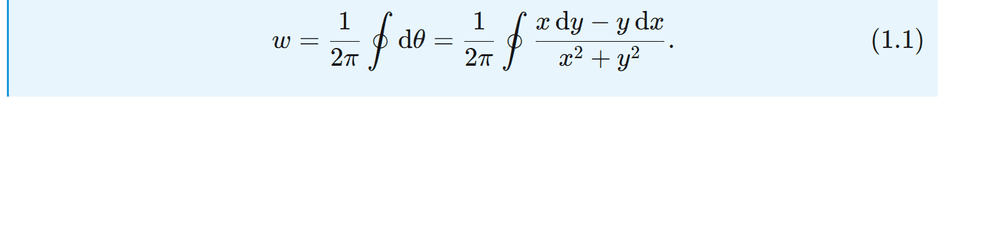
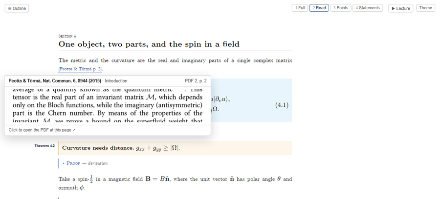
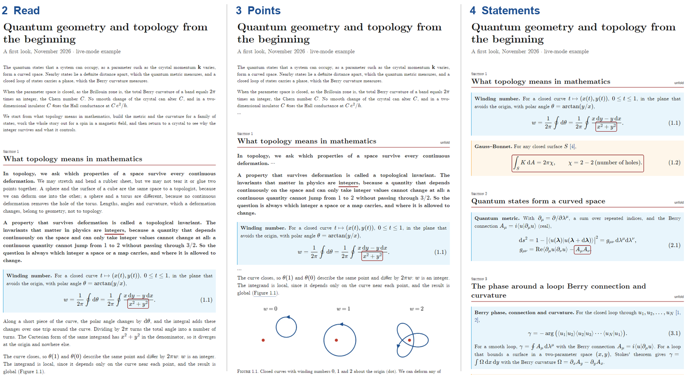

# unfold

Interactive study notes as single, offline HTML files—written with an agent, grounded in source PDFs, foldable to four depths, and playable like a chalkboard lecture.

**Start from whatever literature you already have**: papers, textbook chapters, lecture slides, theses or scanned handwritten notes, as PDFs. unfold is not tied to a field or to the demo topic; any reader with a stack of sources can build a note from them.

**[Live demo: Quantum geometry and topology →](https://harryluoo.github.io/unfold/)**



## Why unfold

Reading dense papers or long AI summaries fails in two familiar ways: heavy notation buries the main thread, while fluent prose hides unverified claims. `unfold` pairs a standalone HTML note engine with a structured teaching loop (`SKILL.md`):

1. **Gather** the sources you have: any PDFs (papers, books, slides, scans), or just a question, in which case the agent finds a textbook and papers.
2. **Calibrate** your starting background and target goal.
3. **Map** the minimal chain of ideas from floor to goal, leaving out tangents.
4. **Write one section at a time**, checking understanding before moving on.
5. **Compile** to one self-contained offline HTML file with KaTeX math, Computer Modern fonts, figures, and cropped PDF citations embedded.

## What a built note can do

### Play like a lecture

The demo opens in Lecture Mode (shown above); step forward with `Space`. Key lines write onto the board, narration advances one sentence at a time below it, and a red pointer tracks the exact symbol or term under discussion. When the lecture ends, the page settles into the regular static note; the "Lecture" button plays it again.

### Verify claims directly against the PDF

Hover any citation chip to inspect a cropped image of the exact passage from the cited PDF, or click to jump straight to that page.



### Fold to four depths

Press `1`–`4` to switch between **Full**, **Read**, **Points** (key sentences, equations, and figures), and **Statements** (headings, definitions, and results).



**Full** is Read with every proof open.

## Quick start

### Install in Claude Code

```text
/plugin marketplace add HarryLuoo/unfold
/plugin install unfold@unfold
```

Put your PDFs in a folder (any papers, chapters, slides or scans you have prepared), open it in Claude Code, and ask:
> *"Build a note with me on these PDFs."*

No PDFs yet? Ask a question instead (*"Teach me Berry curvature from scratch"*) and the agent gathers sources first.

### Use with any coding agent

`unfold` uses plain Markdown instructions and CLI scripts. Point any agent at [`skills/unfold/SKILL.md`](skills/unfold/SKILL.md); it reads `references/` and runs `scripts/build.py` directly.

### Run the engine standalone

A note folder holds `cites.py` (citation registry) and `content.html` (body). Build it in one command with [`uv`](https://docs.astral.sh/uv/):

```bash
uv run skills/unfold/scripts/build.py examples/quantum-geometry
```

Or install dependencies with `pip`:

```bash
pip install -r skills/unfold/requirements.txt
python skills/unfold/scripts/build.py examples/quantum-geometry
```

The build writes one offline file (`examples/quantum-geometry/quantum-geometry.html`). When `node` is on your `PATH`, KaTeX prerenders all math at build time; otherwise the browser renders it on open. Batch builds run via `scripts/rebuild_all.py <manifest.json>`.

### Customize writing style

Prose rules live solely in [`skills/unfold/references/style-default.md`](skills/unfold/references/style-default.md). Swap that file to match your own voice while keeping the teaching workflow and engine intact.

<details>
<summary>Repository layout</summary>

```text
.claude-plugin/          Claude Code plugin and marketplace manifests
skills/unfold/
  SKILL.md               Interactive study loop, note principles, engine reference
  references/            live-mode.md (Lecture Mode markup), style-default.md (prose style)
  scripts/               build.py, notelib.py, rebuild_all.py
  assets/                template.html, lecture.css, lecture.js (inlined at build time)
  requirements.txt       Python dependencies for pip users
examples/
  quantum-geometry/      Live demo source and CC BY 4.0 reference PDF
  notes.json             Example manifest for rebuild_all.py
docs/                    README images
.github/workflows/       CI workflow building and deploying the live demo to GitHub Pages
```

</details>

## Acknowledgments

The idea of reading a text at several levels of detail, from a skeleton down to the full paragraphs, comes from [TextFold](https://github.com/chenxiachan/textfold) by chenxiachan. unfold builds its fold levels from key sentences that the writer marks, and adds Lecture Mode, PDF citation crops and the teaching loop; it shares no code with TextFold.

## License

Code and engine: **MIT** (`LICENSE`).
The example note and cited article (Peotta & Törmä, *Nat. Commun.* 6, 8944 (2015)) carry **CC BY 4.0** (see [`examples/quantum-geometry/LICENSE.md`](examples/quantum-geometry/LICENSE.md)). Built HTML files bundle KaTeX (MIT) and Computer Modern Unicode fonts (SIL OFL 1.1).
